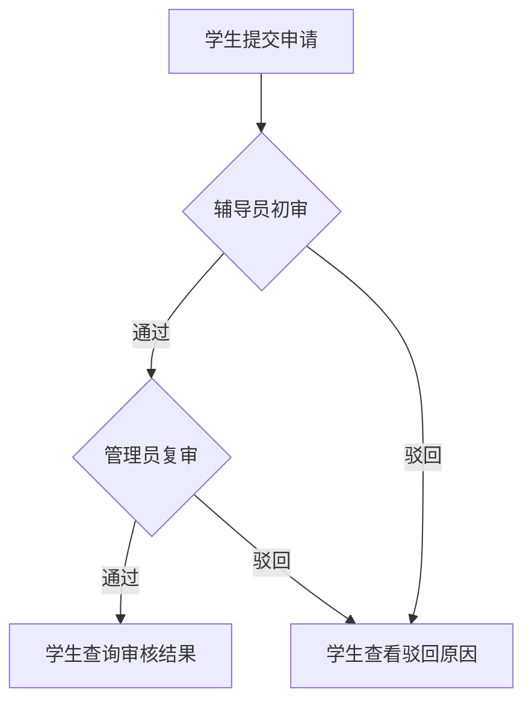

# 奖学金评定系统

高校奖学金申请与两级审核课程项目。核心任务是让学生提交申请并了解审核进度，让辅导员和管理员在各自的审核阶段完成处理。

## 角色与职责

| 角色 | 可操作的环节 | 要查看的信息 |
| --- | --- | --- |
| 学生 | 填写并提交申请，查询结果 | 申请类型、两级审核状态、驳回原因 |
| 辅导员 | 初审，通过或驳回 | 待审申请、成绩与申请信息 |
| 管理员 | 复审，通过或驳回，管理结果 | 初审通过的申请、成绩与名额参考 |

## 实现与测试

使用 Spring Boot、MyBatis、MySQL 和 JSP 实现申请、审核和结果查询等功能。课程项目编制了 34 个模块测试用例。下表是根据申请流程整理的验收场景。

| 场景 | 预期 |
| --- | --- |
| 学生提交有效申请 | 状态进入待辅导员审核 |
| 辅导员初审通过 | 管理员可以在待复审列表查看该申请 |
| 任一级审核驳回 | 学生可区分审核阶段，并查看驳回原因 |
| 管理员复审通过 | 学生可查询最终审核结果 |
